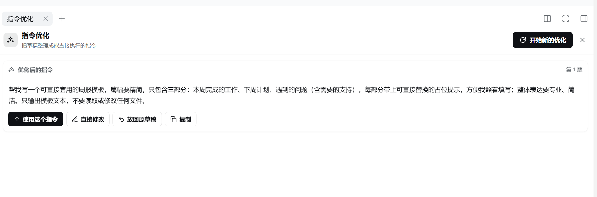
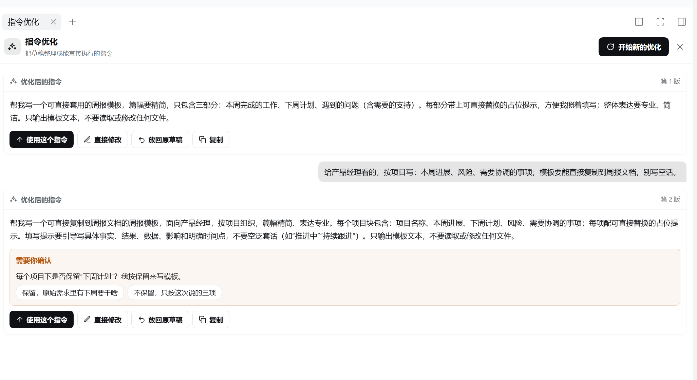

# 指令优化器

**像你的指令秘书一样，把“我想让它做点什么”变成 DSH 真正听得懂、能直接执行的指令。**

你可以说得很口语、很零散，甚至只写一句“把那个地方再弄一下”。插件会结合你们正在做的事，把这句话整理成专业、准确、边界清楚的指令，再交回给你确认。

它不是替你完成任务，而是站在你和 DSH 之间，帮你说清楚真正想要什么。

## 为什么值得用

很多时候，问题不在于 DSH 不够聪明，而在于我们给它的那句话太像“随口一说”：

- 要求藏在上下文里，没有写进指令；
- “这个”“那个”“继续”没有说清指谁；
- 一句话里混着目标、做法、限制和验收标准；
- 怕说少了做错，又怕说多了把范围搞大。

指令优化器就是解决这一段的。它把你的原始想法保留下来，去掉歧义，补上真正会影响结果的约束，再整理成可以直接发送的版本。

## 四个核心能力

### 1. 把原始指令变成更专业、更准确的指令

不是简单润色，也不是套模板，而是先理解你真正想做什么，再重新组织：

- 把口语、错别字、重复和病句理顺；
- 把“随便弄一下”变成可执行的要求；
- 保留文件名、路径、数字、专有名词和 `@文件`；
- 只补会改变结果的遗漏，不擅自增加你没要求的功能；
- 每一版都完整、自包含，可以直接发送，不需要再拼上一版才看得懂。

### 2. 结合当前会话，理解你真正的意思

它不只盯着你这一句话，还会读当前会话里的任务背景、已经做到的进度和已经确认过的约定。

所以当你说：

- “继续第二步”
- “把刚才那个按钮改成蓝色”
- “按之前说的方案来”
- “第 3 条再展开一点”

它会先在这些内容里找到具体对象，再写成明确指令；找不到唯一对象时，会问你，而不是猜一个看起来差不多的东西。

### 3. 通过对话修改，越聊越准

优化结果不是一次定稿。

你可以在右侧栏继续写：

- “第 2 步太啰嗦，保留验收标准”
- “范围改成只做桌面端”
- “不要新增功能，只改颜色”

也可以直接点问题下面的选项。插件会把这一轮反馈和上一版仍然有效的要求合并，输出一版完整的新指令。

如果模型只写了这轮变化、忘了继承上一版，插件会自动再生成一次完整版本。

### 4. 做你和 DSH 之间的沟通桥梁

很多指令失败，不是执行能力不够，而是双方对“做到什么程度”理解不同。

指令优化器会帮你把这几件事说清楚：

- 到底要改什么、不改什么；
- 谁在什么范围内做；
- 哪些是必须满足的验收标准；
- 哪些地方还不确定，需要先问你；
- 哪些文件、附件或引用必须一起带上。

它不会替你做决定，也不会偷偷把任务扩大。它只是把你的意图整理成一份双方都能照着执行的说明。

## 实际演示：从一句口语到可执行指令

下面几张图来自本机实际界面。演示任务只是生成一份周报模板，没有改动任何文件。

### 1. 原始草稿：口语、错别字、范围不清

“模版”“做了啥”“其他你看着办吧”“最好专业一点”都很模糊，也没说给谁看、模板包含什么。

### 2. 第一版：补全对象、结构和边界

优化后直接变成可执行的模板要求：给谁用、包含哪三部分、每部分怎么填、输出什么、不要做什么。

### 3. 继续反馈：保留上一版，再合并新要求

补充“给产品经理看、按项目写、包含风险和需要协调事项”后，第二版没有只回答这句话，而是把上一版要求一起继承，变成完整的新版指令；不确定的地方还给出了可直接点选的选项。

## 它还照顾这些细节

- **附件会一起考虑**：图片交给模型看；小文件读内容；大文件先判断它是什么，不假装逐字读完。
- **`@文件` 不会丢**：优化时保留，使用时重新带回草稿，不会被转走或删除。
- **真正附件会保留**：点「使用这个指令」后，附件和优化后的文字一起发送。
- **只问关键问题**：最多问几个真正会阻塞执行的问题，每个问题给你容易选的大白话选项。
- **你始终有控制权**：不会自动发送，不会自动执行；点「使用这个指令」才会发送，点「直接修改」可以自己改，点「复制」可以拿走。

## 怎么用

1. 在主输入框写下你的草稿，点「优化指令」；
2. 在右侧「指令优化」里看结果；
3. 不满意就在底部继续写反馈，或直接点选项；
4. 满意后点「使用这个指令」；
5. 只想自己改，就点「直接修改」；想拿回最初草稿，点「放回原草稿」。

在主输入框再次点「优化指令」，会直接开始一轮新的优化，不会反复弹确认框。

## 它不会做什么

- 不会替你执行草稿里的任务；
- 不会在你没点「使用这个指令」时自动发送；
- 不会把右侧栏的讨论写进主对话；
- 不会清空主会话；
- 不会为了显得专业而加一堆你没要求的功能。

## 适合这些场景

- 你说话比较口语，担心 DSH 理解偏；
- 你正在做一个多轮任务，希望它别忘了前面的约定；
- 你想在发出去之前，先看看更清楚的版本；
- 你想边聊边改，而不是一次写一大段；
- 你手里有附件或 `@文件`，希望优化和使用时都别丢。

## 一句总结

**你负责说想法，指令优化器负责把它说清楚；最后按不按发送，仍然由你决定。**
